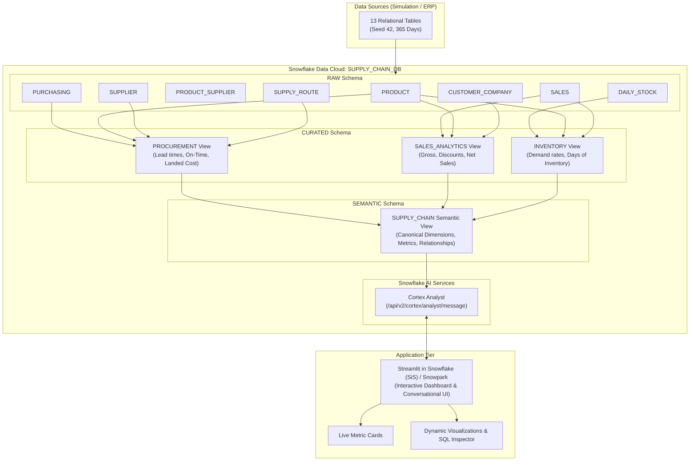
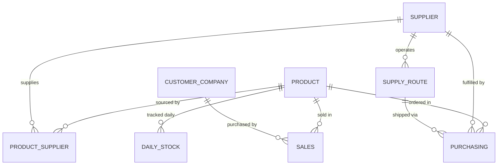

# SupplyIQ: Governed Supply Chain Intelligence on Snowflake

## Table of Contents
1. [Executive Summary](#1-executive-summary)
2. [Problem Statement & Business Context](#2-problem-statement--business-context)
3. [System Architecture](#3-system-architecture)
4. [Dataset & Data Model](#4-dataset--data-model)
   - [Raw Entities](#raw-entities)
   - [Entity-Relationship Diagram](#entity-relationship-diagram)
5. [Data Pipeline & Layered Engineering](#5-data-pipeline--layered-engineering)
   - [Layer 1: Raw Ingestion & Verification](#layer-1-raw-ingestion--verification)
   - [Layer 2: Curated Analytics Layer](#layer-2-curated-analytics-layer)
   - [Layer 3: Governed Semantic Layer](#layer-3-governed-semantic-layer)
6. [Governed KPI Definitions & Formulations](#6-governed-kpi-definitions--formulations)
   - [1. Fill Rate (Fulfillment Rate)](#1-fill-rate-fulfillment-rate)
   - [2. On-Time Delivery (OTD)](#2-on-time-delivery-otd)
   - [3. Landed Cost](#3-landed-cost)
   - [4. Days of Inventory (DOI)](#4-days-of-inventory-doi)
7. [Snowflake Cortex Analyst & AI Integration](#7-snowflake-cortex-analyst--ai-integration)
8. [Streamlit Application (SupplyIQ Portal)](#8-streamlit-application-supplyiq-portal)
9. [Verification & Measured Outcomes](#9-verification--measured-outcomes)
10. [Setup & Deployment Guide](#10-setup--deployment-guide)
11. [Repository Structure](#11-repository-structure)

---

## 1. Executive Summary

**SupplyIQ** is an enterprise-grade, conversational supply chain intelligence solution deployed on **Snowflake**. It bridges the gap between complex, siloed operational data (ERP, Procurement, Logistics, Sales, Inventory) and business decision-makers.

By establishing a **governed semantic layer** and connecting it to **Snowflake Cortex Analyst**, SupplyIQ enables non-technical supply chain managers, procurement officers, and inventory planners to ask natural-language questions and receive hallucination-free, SQL-backed answers with automated visualizations in real-time.

---

## 2. Problem Statement & Business Context

In typical enterprise environments, supply chain data suffers from three critical challenges:

1. **Data Fragmentation Across Silos**:
   Procurement records reside in ERP systems (SAP/Oracle), shipping tracking lives in 3PL transportation management systems (TMS), customer sales sit in CRM/eCommerce databases, and inventory snapshots exist in warehouse management systems (WMS).
2. **Metric Definition Drift**:
   Different teams calculate fundamental KPIs using divergent logic. For instance:
   - *Logistics* measures On-Time Delivery against carrier dispatch windows.
   - *Procurement* measures On-Time Delivery against contractual promise dates.
   - *Inventory Planning* calculates Days of Inventory against 30-day trailing averages, whereas *Finance* uses annual cost-of-goods-sold (COGS).
3. **The LLM Hallucination Trap**:
   Generic AI chatbots queried directly over raw SQL databases frequently invent table relationships, hallucinate non-existent column names, or apply arbitrary math to calculate KPIs.

### SupplyIQ's Solution
SupplyIQ standardizes metric logic at the data tier using Snowflake Views and a governed **Semantic Layer**. Cortex Analyst uses this semantic model as its authoritative blueprint to translate natural language into governed Snowflake SQL, guaranteeing that every query adheres strictly to canonical business definitions.

---

## 3. System Architecture

SupplyIQ is structured into a multi-tier pipeline:



---

## 4. Dataset & Data Model

SupplyIQ is built upon a high-fidelity synthetic 365-day supply chain and ERP simulation (calendar year 2025: `2025-01-01` to `2025-12-31`) generated with a deterministic seed (`seed=42`).

### Raw Entities

SupplyIQ models **8 primary tables** from the simulation suite:

| Entity | Description | Key Attributes |
|---|---|---|
| `PRODUCT` | Master SKU catalog | `product_id`, `product_code`, `product_name`, `category`, `uom`, `base_price`, `base_cost`, `holding_cost_rate` |
| `SUPPLIER` | Vendor profiles & geo locations | `supplier_id`, `supplier_name`, `supplier_city`, `supplier_country`, `is_active` |
| `PRODUCT_SUPPLIER` | Sourcing assignments & MOQ rules | `product_supplier_id`, `product_id`, `supplier_id`, `is_primary`, `min_order_qty` |
| `SUPPLY_ROUTE` | Logistics lanes, transport modes & lead times | `route_id`, `supplier_id`, `origin_city`, `destination_city`, `transport_mode`, `lead_time_mean_days`, `shipment_cost` |
| `PURCHASING` | Inbound purchase orders (PO lines) | `po_line_id`, `product_id`, `supplier_id`, `route_id`, `order_date`, `receipt_date`, `qty_ordered`, `qty_received`, `unit_cost` |
| `CUSTOMER_COMPANY`| B2B buyers & organizational tiers | `customer_id`, `customer_name`, `customer_city`, `customer_segment` |
| `SALES` | Outbound sales transactions | `sales_id`, `product_id`, `customer_id`, `order_date`, `qty`, `unit_price`, `discount_rate` |
| `DAILY_STOCK` | Daily product-level inventory status | `product_id`, `date`, `on_hand_qty`, `in_transit_qty`, `reserved_qty` |

### Entity-Relationship Diagram



---

## 5. Data Pipeline & Layered Engineering

The project implements a 3-tier data warehouse medallion architecture inside Snowflake:

### Layer 1: Raw Ingestion & Verification
Database: `SUPPLY_CHAIN_DB`  
Schemas: `RAW`, `CURATED`, `SEMANTIC`

- **Database Setup** (`sql/01_setup.sql`):
  Initializes the database container and separate schemas to enforce security boundaries and role-based access control.
- **Relational Integrity Verification** (`sql/02_verify_relationships.sql`):
  Executes relational verification queries across multi-table join paths before creating business transformations.

### Layer 2: Curated Analytics Layer
Defined in `sql/03_curated_layer.sql`, this layer pre-joins dimension and fact tables, applying business logic and derived metric definitions:

1. **`CURATED.PROCUREMENT`**:
   - Joins `PURCHASING`, `PRODUCT`, `SUPPLIER`, and `SUPPLY_ROUTE`.
   - Computes:
     - `actual_lead_time_days` = `DATEDIFF('day', pu.order_date, pu.receipt_date)`
     - `expected_receipt_date` = `DATEADD('day', ROUND(sr.lead_time_mean_days), pu.order_date)`
     - `is_on_time` = Boolean flag (`pu.receipt_date <= expected_receipt_date`)
     - `line_fill_rate` = `pu.qty_received / NULLIF(pu.qty_ordered, 0)`
     - `procurement_cost` = `pu.qty_received * pu.unit_cost`
     - `landed_cost` = `(pu.qty_received * pu.unit_cost) + sr.shipment_cost`

2. **`CURATED.SALES_ANALYTICS`**:
   - Joins `SALES`, `PRODUCT`, and `CUSTOMER_COMPANY`.
   - Computes:
     - `gross_sales_amount` = `qty * unit_price`
     - `discount_amount` = `(qty * unit_price) * discount_rate`
     - `net_sales_amount` = `(qty * unit_price) * (1 - discount_rate)`

3. **`CURATED.INVENTORY`**:
   - Computes product-level demand through a Common Table Expression (`PRODUCT_DEMAND`):
     - Calculates total sales volume and active demand span: `DATEDIFF('day', MIN(order_date), MAX(order_date)) + 1`
     - Derives `avg_daily_demand` = `SUM(qty) / NULLIF(demand_period_days, 0)`
   - Joins `DAILY_STOCK` and `PRODUCT` with `PRODUCT_DEMAND`.
   - Computes:
     - `available_qty` = `on_hand_qty - reserved_qty`
     - `days_of_inventory` = `on_hand_qty / NULLIF(avg_daily_demand, 0)`

### Layer 3: Governed Semantic Layer
The semantic layer (`SUPPLY_CHAIN_DB.SEMANTIC.SUPPLY_CHAIN`) encapsulates curated views into standardized models containing dimension attributes, temporal hierarchies, measures, and governed KPI expressions.

---

## 6. Governed KPI Definitions & Formulations

SupplyIQ formalizes four canonical supply chain metrics:

### 1. Fill Rate (Fulfillment Rate)
Quantifies procurement fulfillment efficiency: how much of the ordered quantity was successfully delivered by suppliers.

$$\text{Fill Rate (\%)} = \left( \frac{\sum \text{qty\_received}}{\sum \text{qty\_ordered}} \right) \times 100$$

**SQL Implementation**:
```sql
ROUND(
    100.0 * SUM(qty_received) / NULLIF(SUM(qty_ordered), 0),
    2
) AS fill_rate_pct
```

### 2. On-Time Delivery (OTD)
Measures the percentage of inbound deliveries that arrived on or prior to the route's expected receipt date.

$$\text{Expected Date} = \text{Order Date} + \text{Route Mean Lead Time}$$

$$\text{On-Time Delivery (\%)} = \left( \frac{\sum \mathbb{I}(\text{Receipt Date} \le \text{Expected Date})}{\text{Total Received Deliveries}} \right) \times 100$$

**SQL Implementation**:
```sql
ROUND(
    100.0 * COUNT_IF(is_on_time = TRUE) / NULLIF(COUNT(*), 0),
    2
) AS on_time_delivery_pct
```

### 3. Landed Cost
Calculates the true total cost of acquired goods by incorporating freight and logistics route expenses on top of product procurement purchase costs.

$$\text{Landed Cost} = \sum (\text{qty\_received} \times \text{unit\_cost}) + \sum \text{shipment\_cost}$$

**SQL Implementation**:
```sql
ROUND(SUM(landed_cost), 2) AS total_landed_cost
```

### 4. Days of Inventory (DOI)
Estimates stock runway: the number of days current inventory will satisfy demand assuming historical daily burn rate.

$$\text{Avg Daily Demand} = \frac{\sum_{\text{order\_date}} \text{qty}}{\text{Max(Order Date)} - \text{Min(Order Date)} + 1}$$

$$\text{Days of Inventory} = \frac{\text{On-Hand Qty}}{\text{Avg Daily Demand}}$$

**SQL Implementation**:
```sql
ds.on_hand_qty / NULLIF(pd.avg_daily_demand, 0) AS days_of_inventory
```

---

## 7. Snowflake Cortex Analyst & AI Integration

SupplyIQ interacts directly with **Snowflake Cortex Analyst** through its REST API endpoint (`/api/v2/cortex/analyst/message`).

### How It Works

1. **Authentication**:
   Inside the Snowpark container runtime, the app reads the ephemeral session token from `/snowflake/session/token` and passes it as an OAuth Bearer token.
2. **Contextual Dispatch**:
   The natural-language question is packaged with the reference to the semantic view `SUPPLY_CHAIN_DB.SEMANTIC.SUPPLY_CHAIN`.
3. **Deterministic Query Generation**:
   Cortex Analyst maps terms in the prompt (e.g., "compare on-time delivery by transport mode") to dimensions (`transport_mode`) and metrics (`otd` / `is_on_time`) defined in the semantic model.
4. **Execution & Fallback**:
   The generated SQL is received and executed against Snowflake using the active Snowpark session (`session.sql(sql).to_pandas()`).
   - If Cortex detects ambiguity, it returns clarifying suggestion options rather than hallucinating.

---

## 8. Streamlit Application (SupplyIQ Portal)

The front-end is implemented in `app/streamlit_app.py` using Streamlit in Snowflake (SiS):

- **Executive KPI Dashboard**:
  Cached via `@st.cache_data(ttl=300)`, displaying Live Fill Rate, On-Time Delivery %, and Landed Cost.
- **Natural Language Chat Interface**:
  Text area input supporting freeform prompts as well as one-click suggested questions:
  - *"Which suppliers have the lowest fill rate?"*
  - *"What is the average days of inventory by category?"*
  - *"Compare on-time delivery by transport mode."*
  - *"Which suppliers have the highest landed cost?"*
- **Dynamic Result Table & Auto-Charting**:
  Inspects the column schema of returned dataframes:
  - If 1 category + 1 numeric column: automatically renders a clean Streamlit Bar Chart.
  - If multi-column: displays interactive data grid with expandable chart selector.
- **SQL Transparency Drawer**:
  Provides an expandable `<st.expander>` showing the exact SQL statement generated by Cortex Analyst for total auditing and explainability.
- **Governance Reference Panel**:
  Displays definitions and business logic for all core KPIs at the footer of the page.

---

## 9. Verification & Measured Outcomes

The data transformations and metric outputs have been validated using `sql/04_validate_metrics.sql`:

| Performance Metric | Measured Value | Validation Status |
|---|---|---|
| **Source Tables Integrated** | 8 tables | Verified (`02_verify_relationships.sql`) |
| **Curated Analytical Domains** | 3 views (`PROCUREMENT`, `SALES_ANALYTICS`, `INVENTORY`) | Verified (`03_curated_layer.sql`) |
| **Total Units Ordered** | 371,897 units | Verified (`04_validate_metrics.sql`) |
| **Total Units Received** | 361,078 units | Verified (`04_validate_metrics.sql`) |
| **Fill Rate** | **97.09%** | Formulated & verified |
| **Total Deliveries Analyzed** | 3,159 PO lines | Receipt dates validated |
| **On-Time Delivery (OTD)** | **48.43%** | Formulated & verified |
| **Days of Inventory** | Computed daily per SKU | Verified across active selling days |

---

## 10. Setup & Deployment Guide

### Prerequisites
- Snowflake account with Cortex Analyst enabled.
- Database role with privileges to create databases, schemas, views, and call Cortex endpoints.
- Python 3.9+ with `streamlit`, `snowflake-snowpark-python`, `requests`, `pandas`.

### Step-by-Step Setup

1. **Deploy Snowflake Schemas**:
   Open a Snowflake Worksheet and execute:
   ```sql
   -- Run sql/01_setup.sql
   CREATE DATABASE SUPPLY_CHAIN_DB;
   CREATE SCHEMA SUPPLY_CHAIN_DB.RAW;
   CREATE SCHEMA SUPPLY_CHAIN_DB.CURATED;
   CREATE SCHEMA SUPPLY_CHAIN_DB.SEMANTIC;
   ```

2. **Load Raw Tables**:
   Upload the CSV files located in `Dataset/archive/synthetic_supply_chain_dataset_v3_eng/` into `SUPPLY_CHAIN_DB.RAW` stages and load them into corresponding tables (`PRODUCT`, `SUPPLIER`, `PRODUCT_SUPPLIER`, `SUPPLY_ROUTE`, `PURCHASING`, `CUSTOMER_COMPANY`, `SALES`, `DAILY_STOCK`).

3. **Verify Foreign Keys & Joins**:
   Execute `sql/02_verify_relationships.sql` to verify referential integrity across sales, purchasing, and stock levels.

4. **Build Curated Views**:
   Execute `sql/03_curated_layer.sql` to create `PROCUREMENT`, `SALES_ANALYTICS`, and `INVENTORY` views.

5. **Validate Metrics**:
   Execute `sql/04_validate_metrics.sql` to verify baseline KPIs against the reference figures.

6. **Deploy Streamlit in Snowflake (SiS)**:
   - Navigate to **Snowflake Projects > Streamlit**.
   - Create a new Streamlit app with database `SUPPLY_CHAIN_DB` and schema `CURATED` (or `SEMANTIC`).
   - Paste the contents of `app/streamlit_app.py`.
   - Run the application.

---

## 11. Repository Structure

```text
supplyiq-snowflakes/
│
├── app/
│   └── streamlit_app.py                   # Streamlit front-end application with Cortex Analyst integration
│
├── sql/
│   ├── 01_setup.sql                       # Database & schema creation
│   ├── 02_verify_relationships.sql        # Multi-table foreign key & join verification
│   ├── 03_curated_layer.sql               # Curated views (PROCUREMENT, SALES_ANALYTICS, INVENTORY)
│   └── 04_validate_metrics.sql            # Independent SQL validation tests for KPIs
│
├── assests/                               # Demonstration assets, sample query output CSVs, diagrams
│   ├── 01_setup_data.csv
│   ├── 01_setup_table.png
│   ├── 02_verify_relationship.png
│   ├── 02_verify_relationships.csv
│   ├── 03_curated_layer.csv
│   └── 04_validate_metrics.csv
│
├── Dataset/
│   └── archive/synthetic_supply_chain_dataset_v3_eng/
│       ├── PRODUCT.csv                    # Product catalog master
│       ├── SUPPLIER.csv                   # Supplier profiles
│       ├── PRODUCT_SUPPLIER.csv           # Sourcing & MOQ relationships
│       ├── SUPPLY_ROUTE.csv               # Transit modes, costs & mean lead times
│       ├── PURCHASING.csv                 # Inbound PO lines
│       ├── CUSTOMER_COMPANY.csv           # Customer profiles
│       ├── SALES.csv                      # Outbound order transactions
│       ├── DAILY_STOCK.csv                # Daily stock on hand, in-transit, reserved
│       ├── ABC_SEGMENT_v22.csv            # ABC Pareto classification
│       ├── CALENDAR.csv                   # Calendar dimension
│       ├── SPECIAL_EVENTS.csv             # Disruptive calendar & logistics events
│       ├── WEATHER_CLEAN.csv              # Weather conditions by city
│       └── README.md                      # Dataset documentation & quality reports
│
├── Demo1.mp4                              # Video walkthrough 1
├── Demo2.mp4                              # Video walkthrough 2
├── LICENSE                                # MIT License
├── README.md                              # Repository overview
└── DOCUMENTATION.md                      # Comprehensive project documentation
```

